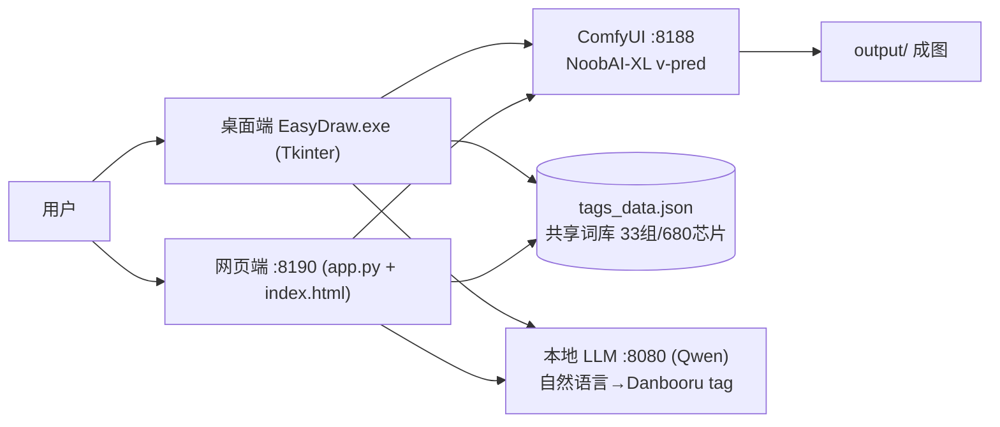

# Easy Draw · 项目结构

本地 AI 生图工作台：**NoobAI-XL v-pred** + ComfyUI，桌面端（Tkinter）与网页端双 UI，Danbooru 词库体系，全离线运行。

## 目录树

```text
easy-ui/                          # 项目根（桌面端 + 网页端共用）
├── easydraw.py                   # 桌面应用主程序（Tkinter · iOS 设计语言 · ~101KB）
│   ├── 词库编辑器                #   按组增删芯片 → 写回 tags_data.json
│   ├── 芯片微渐变动效            #   选中过冲动画（防闪烁实现）
│   └── build_workflow()          #   t2i / i2i / charref 三套工作流
├── app.py                        # 网页后端（:8190，ThreadingHTTPServer）
│   ├── /、/apicfg、/tagsdata     #   页面 / 配置 / 词库读写接口
│   ├── /nlapi                    #   自然语言→提示词（本地词典 + LLM 双路）
│   ├── /upload_b64、/history…    #   参考图上传 / ComfyUI 反向代理
├── index.html                    # 网页前端（单文件：UI + TAG_DB + SYN 词典 + CSS 动效）
├── extract_data.py               # index.html 内联数据 → tags_data.json 抽取器
│
├── tags_data.json                # ★ 共享词库（33 组 / 680 芯片 / 732 词典条目，两端读写）
├── danbooru.csv                  # Danbooru 词表快照（芯片入库白名单校验）
├── api_config.json               # LLM 转换配置（本地 Qwen :8080 / OpenAI 兼容）
├── icon.ico                      # 应用图标
│
├── EasyDraw.exe                  # 打包成品（PyInstaller onefile，~31MB）
├── EasyDraw.spec                 # PyInstaller 打包配置
├── EasyDrawDesktop.bat           # 桌面端一键启动
├── EasyDraw.ps1                  # PowerShell 启动器（带服务预检）
├── StartEasyDraw.bat             # 全家桶启动（ComfyUI + LLM + 界面）
├── StartServices.ps1             # 服务编排（启动 llama-server / ComfyUI）
├── StopEasyDraw.bat              # 一键停止全部服务
│
├── comfyui_desktop.log           # 运行日志（.log/* 建议进 .gitignore）
├── llm_desktop.log
│
├── ios_preview.png               # UI 设计预览稿
├── build/  dist/  __pycache__/   # PyInstaller / Python 构建产物（gitignore）
└── PROJECT_TREE.md               # 本文件
```

## 外部依赖（不进仓库）

```text
C:\AI\ComfyUI\                             # 生图引擎（本地部署）
├── venv/                                  # Python 虚拟环境（后端与打包共用）
├── models/
│   ├── checkpoints/
│   │   └── NoobAI-XL-Vpred-v1.0.safetensors      # 底模 6.62GB（v-pred 非过滤版）
│   ├── ipadapter/
│   │   ├── ip-adapter-plus_sdxl_vit-h.safetensors   # 角色参考 808MB
│   │   └── ip-adapter-plus-face_sdxl_vit-h.safetensors
│   └── clip_vision/
│       └── clip_vision_h_vith.safetensors           # IP-Adapter 视觉编码器
└── output/                                # 成图输出（easy_ui_*.png）
```

## 架构 / 数据流



## 采样链（当前生效）

```text
CheckpointLoader(NoobAI-XL-Vpred-v1.0)
  → ModelSamplingDiscrete(v_prediction + zsnr)     # v-pred 必需
  → RescaleCFG(0.7)                                # 治 CFG 过冲蓝移
  → KSampler(euler_ancestral · normal · 28步 · CFG 5.5)
  → VAEDecode → SaveImage
```

## 建议 .gitignore

```gitignore
build/
dist/
__pycache__/
*.log
*.bak
EasyDraw.exe
tags_data.json.bak
```

> `EasyDraw.exe`（31MB）与 `tags_data.json`（运行时可被用户编辑）是否入库按需取舍：
> 词典建议入库（它是产品数据），exe 建议用 GitHub Releases 发。
