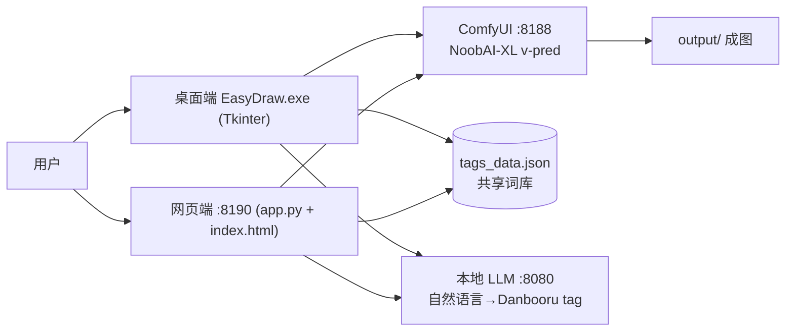

# 🎨 Easy Draw

本地 AI 生图工作台：**NoobAI-XL v-pred** + ComfyUI，桌面端（Tkinter）与网页端双 UI，Danbooru 词库体系，**全程离线运行**（可选本地 LLM 做自然语言转换）。

> ⚠️ **18+ 项目声明**：本工具支持成人向（R18）内容生成，仅限成年人在合法范围内自用。
> **任何涉及未成年人的内容都是绝对红线**——词库编辑器在代码层面硬拦截 `loli / shota / child` 等标签入库，自然语言转换提示词中同样内置硬性拒绝规则。

## ✨ 功能

- **双端 UI**：桌面原生应用（iOS 设计语言、抗锯齿胶囊芯片、微渐变动效）+ 单文件网页版
- **三种生成模式**：文生图 / 图生图 / 角色参考（IP-Adapter Plus + CLIP Vision H）
- **Danbooru 词库体系**：33 组 / 680 枚中文标注芯片，点击即拼提示词，拼写零出错
- **词库编辑器**：按组增删待选标签，两端共用一份数据（`tags_data.json`），内置白名单校验
- **自然语言转换**：本地 732 条词典离线转换，或本地 LLM（OpenAI 兼容接口）深度转换任意中文句子
- **v-pred 色彩修正**：工作流内置 `ModelSamplingDiscrete(v_prediction+zsnr) + RescaleCFG(0.7)`，根治 CFG 过冲蓝移
- **一键服务编排**：ComfyUI / 本地 LLM / 界面 一键启停

## 🗂️ 项目结构

详见 [PROJECT_TREE.md](PROJECT_TREE.md)。

```text
easy-ui/
├── easydraw.py            # 桌面应用主程序（Tkinter）
├── app.py                 # 网页后端 :8190（含 ComfyUI 反代）
├── index.html             # 网页前端（单文件：UI + TAG_DB + SYN 词典）
├── extract_data.py        # index.html → tags_data.json 抽取器
├── tags_data.json         # ★ 共享词库（两端读写）
├── danbooru.csv           # Danbooru 词表快照（白名单校验）
├── api_config.example.json# 本机配置模板（复制为 api_config.json 使用）
└── EasyDrawDesktop.bat    # 一键启动
```

## 🏗️ 架构



## ⚡ 一键安装（Windows）

新机器上双击 **`一键安装.bat`**，自动完成：

| 步骤 | 内容 |
|---|---|
| 1 | 环境检查（磁盘/GPU/代理自动探测） |
| 2 | Python 3.11.9（缺则静默安装） |
| 3 | ComfyUI 引擎（git 浅克隆） |
| 4 | 虚拟环境 + torch CUDA 13.0 + 全部依赖 |
| 5 | IPAdapter 自定义节点（角色参考模式） |
| 6 | 模型下载 ~9.9GB（hf-mirror 国内镜像，断点续传） |
| 7 | Easy Draw 应用（自动生成 `api_config.json`，**不含任何个人 API**） |
| 8 | 可选：本地 LLM（llama.cpp + GGUF，失败不影响出图） |
| 9 | 打包 EasyDraw.exe + 自检 + 桌面快捷方式 |

- 默认安装到 `C:\AI`（与启动脚本的路径约定一致），可用参数改：`.\install.ps1 -InstallDir D:\AI`
- 跳过选项：`-SkipModels`（已有模型）/ `-SkipLLM` / `-SkipBuildExe` / `-DryRun`（只打印步骤）
- 下载源：默认 `hf-mirror.com` 国内镜像，`-UseOfficialHf` 切官方
- pip 镜像默认清华，`-PipMirror` 可换
- 空间需求 ~12GB，耗时 30–90 分钟（取决于网速）

## 🚀 运行环境

| 依赖 | 说明 |
|---|---|
| ComfyUI | 本地部署于 `C:\AI\ComfyUI`（端口 8188） |
| 底模 | `NoobAI-XL-Vpred-v1.0.safetensors`（6.62GB）→ `models/checkpoints/` |
| 角色参考（可选） | `ip-adapter-plus_sdxl_vit-h.safetensors` → `models/ipadapter/`，`clip_vision_h_vith.safetensors` → `models/clip_vision/` |
| 本地 LLM（可选） | 任意 OpenAI 兼容接口（默认 llama-server :8080 + Qwen GGUF） |
| NVIDIA GPU | 实测 RTX 5060 Laptop 8GB，28 步 832×1216 约 40s |

## ⚙️ 配置

```bash
copy api_config.example.json api_config.json   # 再按需修改模型路径
```

## 🔨 从源码打包桌面端

```bash
C:\AI\ComfyUI\venv\Scripts\python.exe -m pip install pyinstaller
C:\AI\ComfyUI\venv\Scripts\python.exe -m PyInstaller --noconfirm --onefile --noconsole ^
  --name EasyDraw --icon icon.ico ^
  --add-data "tags_data.json;." --add-data "danbooru.csv;." --add-data "api_config.json;." ^
  easydraw.py --distpath . --workpath build
```

## 📝 提示词格式

英文 Danbooru 标签，逗号分隔，全小写，多词用空格：

```text
masterpiece, best quality, very aesthetic, 1girl, solo, long hair, blue hair, sailor uniform, classroom, looking at viewer, smile, cherry blossoms, night, wind
```

推荐顺序：质量词 → 人数主体 → 身体特征 → 服装 → 动作表情 → 场景 → 构图 → 画风。详见 [PROJECT_TREE.md](PROJECT_TREE.md)。

## 📄 许可

代码仅供学习交流，未附开源许可证（All Rights Reserved）。模型文件遵循其各自发布协议。
